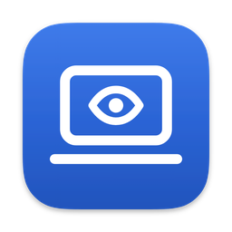
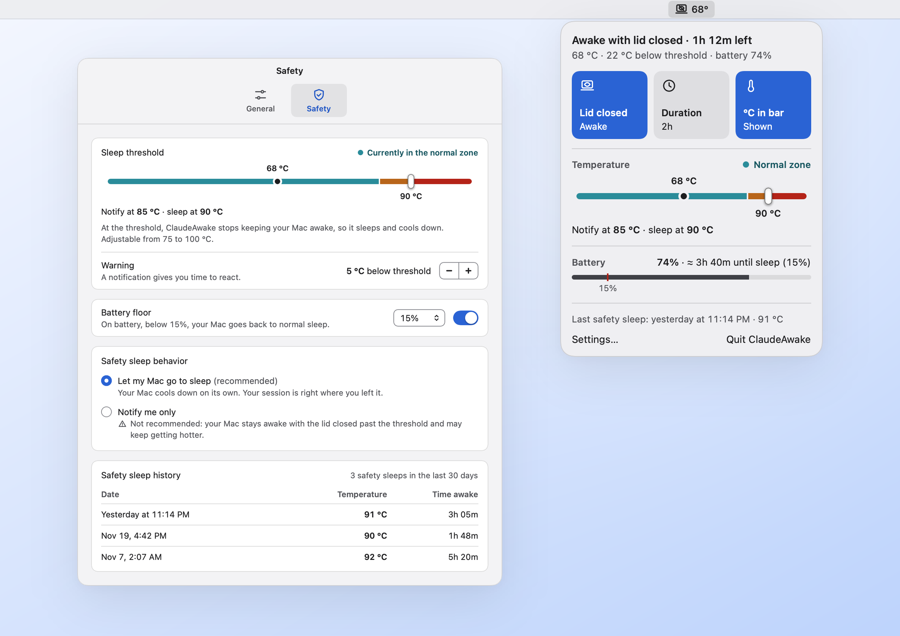
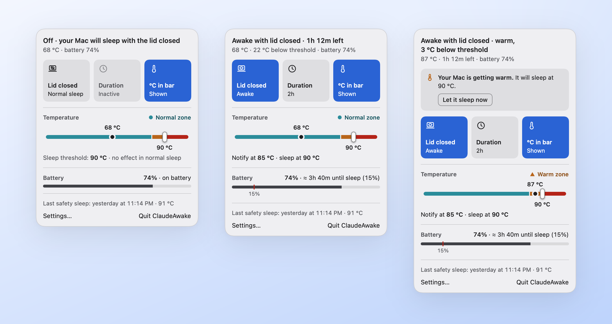
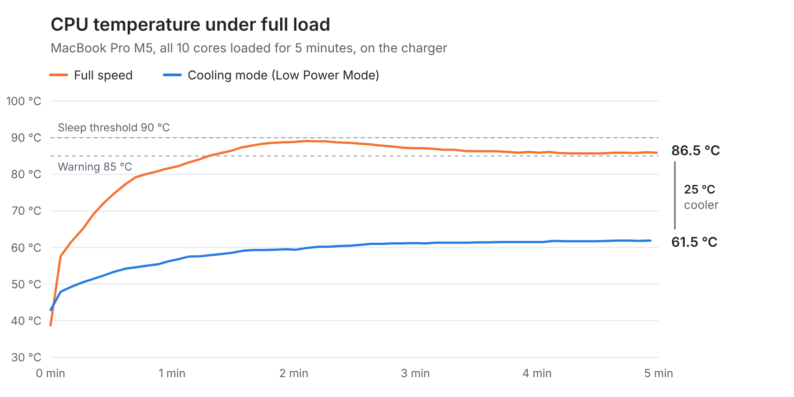

<h1 align="center">ClaudeAwake</h1>

Keep your Mac awake with the lid closed, without letting it overheat.

ClaudeAwake is a small menu bar app for MacBooks with Apple silicon. Close the lid and your Mac keeps
running: long downloads, builds and other tasks carry on. Meanwhile ClaudeAwake watches the CPU temperature.
When it gets warm, ClaudeAwake turns on Low Power Mode, so your Mac cools down and keeps working instead of
heating up in your bag. It still lets your Mac go to sleep normally if it gets too hot or the battery runs low.

**[Download the beta](https://github.com/CaseReed/ClaudeAwake-releases/releases)** · macOS 26 or later ·
Apple silicon · free during the beta

<picture>
  <source media="(prefers-color-scheme: dark)" srcset="assets/screenshot-dark.png">
  
</picture>

## Install

1. Download the DMG from the [latest release](https://github.com/CaseReed/ClaudeAwake-releases/releases),
   open it and drag ClaudeAwake to Applications.
2. Open ClaudeAwake. The beta is not notarized by Apple yet, so macOS says it cannot verify it: click Done.
   Then open System Settings › Privacy & Security, click Open Anyway next to ClaudeAwake, and confirm.
3. The welcome window does the rest: install the system helper, then allow it in
   System Settings › General › Login Items & Extensions.

## What it does

- **Lid closed mode.** Turn it on from the menu bar icon or with ⌥⌘A. Keep it on until you turn it off,
  or for 1, 2 or 4 hours.
- **Cooling mode.** When the CPU warms up (85 °C by default), ClaudeAwake turns on Low Power Mode: your Mac
  gives up some speed, runs much cooler and keeps working. Your own Low Power Mode setting comes back once the
  Mac has cooled down, or when the session ends. You can turn it off in Settings › Safety › Cool down before sleeping.
- **Safety sleep.** If the Mac still gets too hot, at your sleep threshold (90 °C by default, 75 to 100 °C)
  ClaudeAwake lets it go to sleep. Your session is right where you left it.
- **Battery floor.** On battery, it lets your Mac sleep when the charge falls to 15 % (10 to 25 %, or off).
- **At a glance.** The temperature in the menu bar if you want it, and the display turns off when you close
  the lid.

<picture>
  <source media="(prefers-color-scheme: dark)" srcset="assets/states-dark.png">
  
</picture>

### How much cooler

Measured on a MacBook Pro with an M5 chip, on the charger, with all 10 cores fully loaded for 5 minutes:

<picture>
  <source media="(prefers-color-scheme: dark)" srcset="assets/cooling-chart-dark.png">
  
</picture>

| | Full speed | Cooling mode |
|---|---|---|
| CPU temperature (average) | 86.5 °C | 61.5 °C |
| Hottest core | 98.8 °C | 65.5 °C |
| Power drawn by the Mac | 38 W | 16 W |
| Work done | 100 % | 73 % |

Your Mac keeps about three quarters of its speed, about 25 °C cooler, at less than half the power.
Results vary with the Mac and the load.

## How it stays safe

Keeping a Mac awake with the lid closed needs a small system helper, which you approve once in
System Settings. It only acts while the app keeps renewing a short lease of about 90 seconds: it disables
sleep, and in cooling mode it turns on Low Power Mode, after saving your own setting.

- If ClaudeAwake quits, crashes or freezes, the lease runs out and your Mac gets its normal sleep and your
  Low Power Mode setting back.
- Turning the mode off, or a safety sleep, gives them back right away.

## Privacy

There is no account. ClaudeAwake makes two kinds of network requests:

- **The daily update check**, which reads `appcast.xml` from this repository.
- **Anonymous usage statistics** (from version 0.4.0), sent to [TelemetryDeck](https://telemetrydeck.com/faq/),
  a privacy-first analytics service hosted in the EU. They tell us how many Macs use ClaudeAwake and how
  lid-closed mode is used:
  - when the app is first installed, each time it starts, and once a day while it runs;
  - when lid-closed mode starts (with the duration you chose) and ends (why it ended, and its length rounded,
    such as "1 to 2 hours");
  - when the system helper is allowed.

  TelemetryDeck's library adds technical details to each of these: the app and macOS versions, your Mac's model
  and architecture, screen size, appearance, a few accessibility settings, language, region, time zone, the day and
  hour, and usage counters such as how many days and sessions the app was used and how long sessions last. Each
  Mac is counted with a random identifier that comes from nothing on your Mac and is hashed before it leaves it.
  Never your name, files or temperatures, and TelemetryDeck does not store IP addresses. Turn it off any time in
  Settings › General › Share anonymous usage statistics: nothing new is recorded after that.

Logs stay on your Mac until you export them and send them yourself.

## Updates and the end of the beta

ClaudeAwake checks for a new version once a day and asks before installing it. You can also check from
Settings › General › Check for updates. Each beta works until the date shown there. After that, lid-closed
mode stays off until you install a newer version.

## Feedback

Found a bug? In the app, Settings › General › Feedback › Report a bug… opens the form with your app version and
Mac model already filled in. For an idea, or if you are not at your Mac, [open an issue](https://github.com/CaseReed/ClaudeAwake-releases/issues/new/choose).
Say what happened, when, and what you expected. The logs from Settings › General › Diagnostics › Export… help a
lot: the zip holds the app's temperature and battery samples, its events, your settings and your Mac's model.
Issues are public, so attach it only if you are fine with that.

## Uninstall

Quit ClaudeAwake from its menu and move it to the Trash. If it still shows in
System Settings › General › Login Items & Extensions, switch it off there.

---

ClaudeAwake is free during the beta and provided as is, without warranty. All rights reserved.
